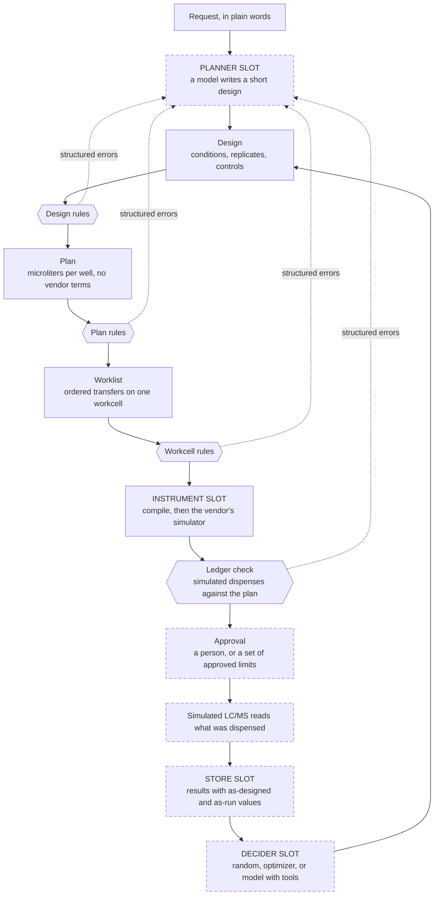

# lab_automation

A checked path from a model's experiment idea to a liquid handler protocol, with a simulated closed loop.

## What this is

Language models can now propose experiments, but a proposal is not something a liquid handling robot can run, and not something a lab should trust without checks.
This repository is the layer in between: fixed code turns a short experiment design into a checked, simulated liquid handler protocol, and a person stays at the approval step.
The plan is to close the loop with a simulated analytical instrument, so that a model can choose the next round from the data.

Everything here runs in simulation. See [Limits](#limits) and the [status table](#what-is-real-and-what-is-simulated).

## The idea in one picture



Dashed boxes are not built yet. The four slots (planner, instrument, store, decider) sit behind small interfaces so each can be swapped.

## See it run

```
python3 -m venv .venv && . .venv/bin/activate
pip install -e ".[dev,tecan]"
labauto demo
```

The `[tecan]` extra adds PyLabRobot for the second instrument. Without it, that demo row prints `SKIPPED (pylabrobot not installed)`.

Output of `labauto demo` from a real run:

```
$ labauto demo
Stage 1: designs and plans through the check pipeline

case                         result   layer      detail
good_factorial               PASS                40 wells, 645 steps simulated, ledger matches
bad_off_grid                 CAUGHT   design     FACTOR_OFF_GRID catalyst_mol_pct=2.2 (nearest 2.0, 2.5)
bad_too_many_wells           CAUGHT   design     TOO_MANY_WELLS 120 needed, 92 available
bad_reagent_short            CAUGHT   workcell   SOURCE_SHORT catalyst 1328 uL needed, 1080 usable
bad_overfill                 CAUGHT   plan       WELL_OVERFILL plate:E1 600 uL, limit 250
deck_conflict                CAUGHT   workcell   DECK_CONFLICT slot 2: plate, reservoir
good_factorial (tecan_evo)   PASS                same plan, second instrument
```

Each row is one input sent through the check pipeline. The last row sends the same design to a second workcell, a Tecan EVO, and confirms the plan is identical: only the instrument backend changes. Every failure is caught at a named layer, with the numbers that explain it. The run folders land in `runs/`. One of them is committed as [examples/sample_run/](examples/sample_run/).

## How a bad plan gets caught

Stage 1 has no model yet, so this example starts from a design file. `examples/designs/bad_reagent_short.json` asks for 33 conditions at 10 mol % catalyst, in duplicate:

```
"grid": {"catalyst_mol_pct": [10.0], "base_equiv": [0.5, 0.75, 1.0, 1.25, 1.5, 1.75, 2.0, 2.25, 2.5, 2.75, 3.0], "cosolvent_pct": [0.0, 20.0, 40.0]}
"replicates": 2
```

The design rules pass: every value is allowed and 70 wells fit on the plate. The workcell rules then add up what the worklist would draw from each source. `labauto check examples/designs/bad_reagent_short.json` stops at the workcell layer, and `errors.json` in the run folder holds the error as data:

```json
[
  {
    "code": "SOURCE_SHORT",
    "layer": "workcell",
    "where": "inventory:catalyst",
    "message": "The design needs 1328 uL of catalyst. 1080 uL is usable (1200 uL loaded, 10% held back as dead volume).",
    "fix_hint": "Use fewer wells or lower catalyst amounts, or ask for more catalyst to be loaded.",
    "options": [
      "reduce_wells",
      "lower_values",
      "ask_human_to_load_more"
    ],
    "needs_human": false,
    "short": "catalyst 1328 uL needed, 1080 usable"
  }
]
```

The numbers are in the message, the hint says what would fix it, and `options` names the kinds of change that would work. A planner model reads exactly this object when it repairs its own design (Stage 2, not built yet).

## Why it is built this way

- P1. The model never writes robot code. It writes a short design, and fixed code does everything after that.
- P2. Check before you run: rules first, then the vendor's simulator, then a person.
- P3. Errors are data: every failure is structured, specific, and carries a hint, so a model can repair its own design.
- P4. Escalate, do not loop: retries are bounded, then a larger model gets one try, then a person.
- P5. Nothing changes silently: any difference between what was asked and what is planned is listed at approval.
- P6. Record everything: what was designed, what was run, who decided, and hashes that tie approval to the exact protocol.
- P7. Numbers come from code. Words may come from a model, and reports mark which is which.
- P8. Parts are swappable: planner, instrument, decider, and store sit behind small interfaces.
- P9. It runs anywhere: the full demo runs on a laptop with no GPU and no API key.
- P10. Honest scope: everything here is simulation, and the status table says what is built.

## What is real and what is simulated

| Part | Status |
|---|---|
| Design, plan, worklist, validators | built and tested |
| Opentrons OT-2 protocol generation | built, checked in the vendor's simulator, never run on a robot |
| Tecan EVO backend | built, bookkeeping simulation only |
| Planner agent, repair, escalation, approval | not built |
| LC/MS readout | not built |
| Closed loop | not built |
| Service API, skill library | not built |
| Real hardware, LIMS or ELN, cluster deployment | not built |

## Results

No model results yet. The planner evaluation and the closed loop benchmark arrive with Stages 2 and 3.

## Plug in your own

The four slots:

| Slot | Interface | Built |
|---|---|---|
| Planner | `propose(context) -> PlannerOutput` | not yet |
| Instrument | `compile(worklist, workcell, plan, out_dir) -> Path`, `simulate(artifact, workcell) -> SimResult` | Opentrons OT-2, Tecan EVO (simulated) |
| Decider | `decide(history, n, brief, seed) -> Decision` | not yet |
| Store | `append_results`, `load_results`, `save_record` | not yet |

A new instrument backend is one module in `src/labauto/instruments/` with five parts:

1. `labware_map()` and `pipette_map()`: neutral keys such as `plate_96_flat_360ul` to the vendor's names.
2. `valid_position(position)`: what a deck position looks like on that instrument.
3. `compile(...)`: write the protocol file from the worklist. One aspirate per dispense keeps the record simple.
4. `simulate(...)`: run the protocol in the vendor's simulator and return the step log, a ledger of what was dispensed into each well, the tips used, and a mapped error.
5. One line in the registry in `src/labauto/instruments/__init__.py`, keyed by the workcell's `instrument` string.

Nothing upstream changes: the design, plan, and worklist are vendor neutral.

## Limits

- Simulation only. No physical run has been made with this code.
- An OT-2 with organic solvents is a poor match in practice: volatile liquids drip and some plastics do not hold up. Real reaction screening runs on other hardware. That is the reason the instrument is a slot.
- One liquid handling rule stands in for liquid classes. Real methods need calibrated liquid classes, labware definitions taught on the actual deck, and mixing steps.
- The Tecan backend checks volumes and tips, not collisions, calibration, liquid classes, or timing. It runs on PyLabRobot's bookkeeping simulator and has never driven a real instrument.
- The Opentrons simulator does not catch an overfilled well, a volume below a pipette's minimum, or a source well drawn dry. Rules in this repository catch those. See [docs/tooling_notes.md](docs/tooling_notes.md).
- No scheduler, no multi-instrument coordination, no sample tracking system.

## What real hardware would add

- Deck teaching and calibration.
- Liquid classes and liquid level detection.
- Handling of hardware errors such as failed tip pickups and clots.
- The vendor's own control software and drivers.
- Scheduling across instruments.
- Write back to a LIMS or ELN.
- Safety interlocks.

## How this was built

Designed and directed by the repository owner. The code was written with an AI coding assistant from a written specification, [SPEC.md](SPEC.md) in this repository. Everything is tested in simulation only.

## Docs

- [docs/tooling_notes.md](docs/tooling_notes.md): what each simulator checks and misses, with the tests that prove each point.
- [docs/decisions.md](docs/decisions.md): choices made where the specification was silent, and open problems.

## Background

- Opentrons Python Protocol API: https://docs.opentrons.com/v2/
- PyLabRobot: https://docs.pylabrobot.org (used for the Tecan EVO simulation)
- Self-Building Labs: https://self-building-labs.github.io/ (arXiv 2610.23826). That work builds lab capabilities in simulation before physical trials and saves validated skills for reuse. This repository borrows the simulate first habit.

## License

MIT. See [LICENSE](LICENSE).
