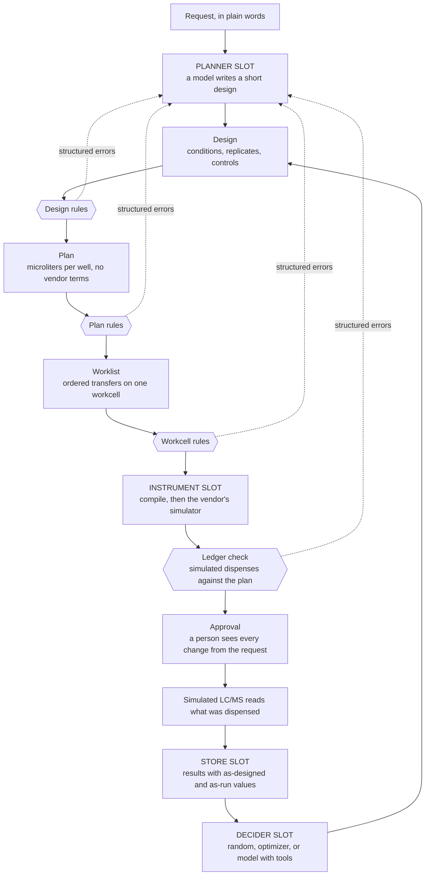
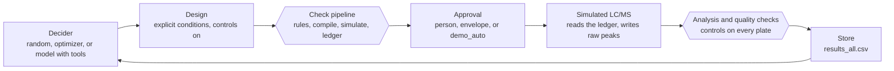
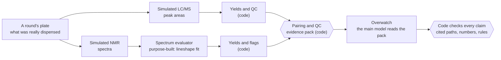
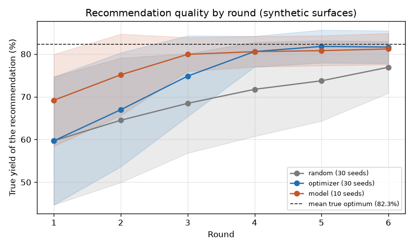

# lab_automation

A checked path from a model's experiment idea to a liquid handler protocol, with a simulated closed loop.

## What this is

Language models can now propose experiments, but a proposal is not something a liquid handling robot can run, and not something a lab should trust without checks.
This repository is the layer in between: fixed code turns a short experiment design into a checked, simulated liquid handler protocol, and a person stays at the approval step.
It then closes the loop with a simulated analytical instrument, so that a decider can choose the next round from the data. A second simulated readout (NMR) can be paired with the LC/MS, and a model reviews the paired data while code checks what it says.

Everything here runs in simulation. See [Limits](#limits) and the [status table](#what-is-real-and-what-is-simulated).

## The idea in one picture



Every box is built, in simulation. The four slots (planner, instrument, store, decider) sit behind small interfaces so each can be swapped.

## See it run

```
python3 -m venv .venv && . .venv/bin/activate
pip install -e ".[dev,tecan]"
labauto demo
```

The `[tecan]` extra adds PyLabRobot for the second instrument. Without it, that demo row prints `SKIPPED (pylabrobot not installed)`.

Output of `labauto demo` from a real run:

```
$ labauto demo
Stage 1: designs and plans through the check pipeline

case                         result   layer      detail
good_factorial               PASS                40 wells, 645 steps simulated, ledger matches
bad_off_grid                 CAUGHT   design     FACTOR_OFF_GRID catalyst_mol_pct=2.2 (nearest 2.0, 2.5)
bad_too_many_wells           CAUGHT   design     TOO_MANY_WELLS 120 needed, 92 available
bad_reagent_short            CAUGHT   workcell   SOURCE_SHORT catalyst 1328 uL needed, 1080 usable
bad_overfill                 CAUGHT   plan       WELL_OVERFILL plate:E1 600 uL, limit 250
deck_conflict                CAUGHT   workcell   DECK_CONFLICT slot 2: plate, reservoir
good_factorial (tecan_evo)   PASS                same plan, second instrument

Stage 2: planner scenarios, replayed from recorded sessions

scenario                     state               attempts  detail
01_simple_factorial          AWAITING_APPROVAL   1         40 wells, no deviations
02_too_big                   AWAITING_APPROVAL   2         84 wells, repaired MISSING_FACTOR, UNKNOWN_FACTOR, 1 deviation declared
03_out_of_range              AWAITING_APPROVAL   1         20 wells, 2 deviations declared

Source of 01_simple_factorial: recorded session of qwen3.8:27b.
Source of 02_too_big: recorded session of qwen3.8:27b.
Source of 03_out_of_range: recorded session of qwen3.8:27b.
A person approves with labauto approve <run>. Nothing here was approved.

Stage 3: closed loop, full path (compile, simulate, ledger check, simulated LC/MS)

optimizer: DONE after 3 rounds. Every round approved by demo_auto (no person).
| Round | Best measured mean so far (%) | Quality events | Approval | Fallback | Decided by |
|---|---|---|---|---|---|
| 1 | 73.3 | none | demo_auto | none | shared Latin hypercube (code) |
| 2 | 87.4 | IS_OUT_OF_RANGE | demo_auto | none | optimizer (code) |
| 3 | 87.4 | IS_OUT_OF_RANGE | demo_auto | none | optimizer (code) |
The condition with the highest measured mean: catalyst_mol_pct 7.0, base_equiv 1.75, cosolvent_pct 20.0, mean 87.4% over 3 valid wells.
Report: runs/campaigns/c-20261111T204009Z-optimizer-e5dd/report.md

model decider, recorded session of qwen3.8:27b: DONE after 3 rounds. Every round approved by demo_auto (no person).
| Round | Best measured mean so far (%) | Quality events | Approval | Fallback | Decided by |
|---|---|---|---|---|---|
| 1 | 73.3 | none | demo_auto | none | shared Latin hypercube (code) |
| 2 | 86.6 | IS_OUT_OF_RANGE | demo_auto | none | model qwen3.8:27b |
| 3 | 87.6 | IS_OUT_OF_RANGE | demo_auto | none | model qwen3.8:27b |
The condition with the highest measured mean: catalyst_mol_pct 6.0, base_equiv 1.75, cosolvent_pct 20.0, mean 87.6% over 2 valid wells.
Report: runs/campaigns/c-20261111T204016Z-model-02ad/report.md

Run folders are in runs/. Finished in 18.2 s.
```

In the first table, each row is one input sent through the check pipeline. The Tecan row sends the same design to a second workcell, a Tecan EVO, and confirms the plan is identical: only the instrument backend changes. Every failure is caught at a named layer, with the numbers that explain it. The run folders land in `runs/`. One of them is committed as [examples/sample_run/](examples/sample_run/).

The second table replays three planner sessions recorded live on qwen3.8:27b, a local model served by Ollama. Each is trial 1 of the first core evaluation run for that scenario, taken by that rule and not picked. Everything after each reply (the checks, the repair prompts, the ladder, the approval summary) is the real code. In 02 the model's first JSON misnamed two factors; the checks caught it and the repair passed. The scripted sessions used before any model was available are kept as `examples/recordings/*.scripted.jsonl`. The last table replays a live qwen3.8:27b model decider session with the same seeds. `labauto demo --live` runs the planner scenarios against the configured endpoint. `tests/test_live_recordings.py` checks that each recording comes from a model, holds nothing private, and replays to the same result.

## How a bad plan gets caught

One request, start to finish. The planner replies here are scripted, written by hand (`examples/scripted/02_too_big.json`). The errors, the repair prompt, and the summary are produced by the code. Command:

```
labauto plan --request-file examples/requests/02_too_big.txt --client scripted:examples/scripted/02_too_big.json --runs runs/readme02
```

The request asks for 40 conditions in triplicate. The planner's first design keeps all of it. The design rules stop it, and this is `attempts/01_local/errors.json`:

```json
[
  {
    "code": "TOO_MANY_WELLS",
    "layer": "design",
    "where": "conditions x replicates",
    "message": "The design needs 120 sample wells (40 conditions x 3 replicates). 92 sample wells are available with controls on. At most 2 replicates of 40 conditions fit.",
    "fix_hint": "Use 2 replicates, or fewer conditions.",
    "options": [
      "reduce_replicates",
      "reduce_conditions"
    ],
    "needs_human": false,
    "short": "120 needed, 92 available"
  }
]
```

That object goes back to the planner as part of its next prompt, with the earlier design. The second design keeps every condition, uses 2 replicates, and declares the cut:

```json
"replicates": 2,
"deviations": [
  {
    "requested": "3 replicates (triplicate)",
    "planned": "2 replicates",
    "reason": "40 conditions in triplicate need 120 sample wells and 92 are available. Keeping every condition and cutting to 2 replicates needs 80."
  }
]
```

It passes every layer: design rules, plan rules, workcell rules, the Opentrons simulator, and the ledger check. The run then waits for a person. The top of its `summary.md`:

```
# Run 20261111T060027Z_284c: AWAITING_APPROVAL

## Request

> "Test every catalyst loading from 1 to 10 mol % in 1 % steps against base at 1.0, 1.5, 2.0 and 2.5 equivalents, 20% co-solvent, in triplicate."

## Changes from what was asked

From the planner's deviations list.

- asked: 3 replicates (triplicate)   planned: 2 replicates   why: 40 conditions in triplicate need 120 sample wells and 92 are available. Keeping every condition and cutting to 2 replicates needs 80.

## Assumptions

- Controls on: negative and reference controls in A1 to D1 (assay default).

## How we got here

- attempt 1  local-main (scripted)  failed  TOO_MANY_WELLS
- attempt 2  local-main (scripted)  passed

To approve: `labauto approve runs/readme02/20261111T060027Z_284c`    To reject: `labauto reject runs/readme02/20261111T060027Z_284c --reason "..."`
```

Below that, the summary lists what would be run, reagent use, tips, and each check. `approval.json` records who approved, when, and the design and protocol hashes. If either file changes after approval, the approval is void.

### The same request on a local model

This is a live run of the same request on qwen3.8:27b served by Ollama: trial 1 of the first core evaluation run, not picked for the example. It ran before the schema sent to the server listed the assay's factor names. The model did the arithmetic right on its first try and cut to 2 replicates. But the JSON it returned named two factors `encoding` and `encoding_pct`. Its own reasoning, recorded in the transcript, used the right names, `base_equiv` and `cosolvent_pct`. The design rules caught the slip as `UNKNOWN_FACTOR` and `MISSING_FACTOR`, the errors went back, and the second attempt passed. The top of its `summary.md`:

```
# Run 20261111T172718Z_f197: AWAITING_APPROVAL

## Request

> "Test every catalyst loading from 1 to 10 mol % in 1 % steps against base at 1.0, 1.5, 2.0 and 2.5 equivalents, 20% co-solvent, in triplicate."

## Changes from what was asked

From the planner's deviations list.

- asked: triplicate (3 replicates)   planned: duplicate (2 replicates)   why: 10 catalyst × 4 base = 40 conditions; 40 × 3 = 120 sample wells exceeds the 92 available with controls. Reducing to 2 replicates gives 80 sample wells (84 total with 4 control wells), which fits.

## Assumptions

- cosolvent_pct fixed at 20.0 % v/v as specified in the request

## How we got here

- attempt 1  local-main (qwen3.8:27b)  failed  MISSING_FACTOR, UNKNOWN_FACTOR
- attempt 2  local-main (qwen3.8:27b)  passed
```

## The closed loop

Each round, a decider picks conditions, code builds the design, and the plate
goes through the same checked path as any other design. Then a simulated LC/MS
reads what the simulator says was dispensed, and the results feed the next
decision.



Round 1 is the same Latin hypercube for every strategy. The yield surface
behind the simulated LC/MS is made up and hidden from every decider. With the
`envelope` approval policy, a person approves round 1, and later rounds are
approved automatically while the plate size, assay, and workcell stay the
same and nothing unusual happened; a failed plate or a decider fallback sends
the next round back to a person. The plate and tips are assumed fresh each
round, and reagents topped up.

A campaign report excerpt, from `labauto loop --strategy optimizer --approval auto_demo --brief "Find the condition with the highest yield."` (6 rounds, full path):

- brief: Find the condition with the highest yield.
- strategy: optimizer; rounds: 6; conditions per round: 8; replicates: 3
- seed: 1; surface seed: 0; approval: auto_demo; faults: injection_failure
- assay: generic_reaction_screen_v1; workcell: ot2_bench; state: DONE

| Round | Best measured mean so far (%) | Quality events | Approval | Fallback | Decided by |
|---|---|---|---|---|---|
| 1 | 73.3 | none | demo_auto | none | shared Latin hypercube (code) |
| 2 | 87.4 | IS_OUT_OF_RANGE | demo_auto | none | optimizer (code) |
| 3 | 87.4 | IS_OUT_OF_RANGE | demo_auto | none | optimizer (code) |
| 4 | 87.4 | none | demo_auto | none | optimizer (code) |
| 5 | 87.4 | IS_OUT_OF_RANGE | demo_auto | none | optimizer (code) |
| 6 | 87.4 | none | demo_auto | none | optimizer (code) |

Top 5 conditions:

| Condition | Mean (%) | SD | n | Flags |
|---|---|---|---|---|
| catalyst_mol_pct 7.0, base_equiv 1.75, cosolvent_pct 20.0 | 87.4 | 3.6 | 3 | none |
| catalyst_mol_pct 8.0, base_equiv 1.75, cosolvent_pct 20.0 | 86.9 | 2.0 | 2 | IS_OUT_OF_RANGE |
| catalyst_mol_pct 6.5, base_equiv 1.75, cosolvent_pct 20.0 | 86.6 | 2.2 | 3 | none |
| catalyst_mol_pct 6.0, base_equiv 1.75, cosolvent_pct 20.0 | 86.6 | 3.1 | 3 | none |
| catalyst_mol_pct 6.5, base_equiv 1.75, cosolvent_pct 25.0 | 85.2 | 5.1 | 3 | none |

The condition with the highest measured mean: catalyst_mol_pct 7.0, base_equiv 1.75, cosolvent_pct 20.0, mean 87.4% over 3 valid wells.

Measured means include the simulated instrument noise, so a mean can sit above the hidden surface's true optimum. The benchmark below scores recommendations by their true yield instead.

The model decider has also run live, once: `labauto loop --strategy model --approval auto_demo --rounds 6 --seed 1 --surface-seed 0` on qwen3.8:27b. It chose all five rounds after the shared round 1, with no fallback, and recommended catalyst 6.5 mol %, base 1.75 equiv, co-solvent 20 %, measured at 86.6 % over 9 wells. That is the hidden surface's grid optimum (SPEC.md Appendix C). Its calls are committed as `examples/recordings/decider.jsonl`, and `labauto loop --strategy model --approval auto_demo --rounds 6 --seed 1 --surface-seed 0 --client replay:examples/recordings/decider.jsonl` replays the whole campaign to the same table. One campaign on one surface is an example, not a benchmark.

Traceability, first rows. The report lists every well behind the recommendation, with the hashes of the design and protocol that made it:

| Run folder | Well | Yield (%) | Excluded | Design hash | Protocol hash |
|---|---|---|---|---|---|
| rounds/02 | F1 | 89.3 | false | a03b01b93099e8a4 | ef3758320dd3f2a3 |
| rounds/02 | D3 | 83.2 | false | a03b01b93099e8a4 | ef3758320dd3f2a3 |
| rounds/02 | A4 | 89.6 | false | a03b01b93099e8a4 | ef3758320dd3f2a3 |

## Paired LC/MS and NMR, and a data reviewer

A second simulated readout, a 1H NMR, reads the same wells as the LC/MS. Code pairs the two readouts, and a model reviews the paired data. This is the order of trust:



1. A purpose-built evaluator reads each spectrum. Here it is a classical least squares lineshape fit behind a small interface, so a trained model can take its place. On synthetic spectra ([docs/nmr.md](docs/nmr.md), `labauto nmr-check`), its mean absolute error is 0.29 points of yield on clean spectra against 1.37 for plain integration with a phase correction, 0.54 against 3.83 when the lines are broadened by a poor shim, and 0.27 against 1.42 with a 15 degree phase error. It takes about 30 ms a spectrum.
2. The product has two NMR signals, fitted independently. An impurity hiding under one makes them disagree, and the evaluator flags the well: 9 % of impurities under 5 points, 93 % from 5 to 10, and all of those over 10, with no false alarm on the same 120 spectra without the impurity.
3. Code pairs the readouts per condition and flags where LC/MS and NMR disagree. The evidence pack holds no truth.
4. The overwatch, the generalist main model, judges each condition (accept, flag, or rerun) and names suspected faults. It must cite the evidence for each verdict, and code rejects any number not found where it is cited.

`labauto nmr <campaign> --round N` adds the NMR to a finished round and writes `paired.md`. `labauto review <campaign> --round N` runs the overwatch; `--client qc-only` runs fixed rules instead.

The test: `labauto eval-reviewer` injects known faults into 12 plates (failed injections, a drifting LC/MS, broadened NMR lines, a phase error, impurities; three hard cases have no dedicated flag) and scores three reviewers against the true fault log: the plain QC rules, the QC rules plus two plate statistics (no model), and the overwatch. The default prompt describes fault signatures that resemble how the hard cases were built, so the evaluation also runs a prompt without them.

Results, from `labauto eval-reviewer --trials 1` with the default prompt ([page](docs/reviewer_eval.md)) and with `--prompt no_hints` ([page](docs/reviewer_eval_no_hints.md)). The overwatch is qwen3.8:27b. The 12 plates hold 13 true faults; 23 wells hold a failed injection or an impurity. Each case ran once.

| Reviewer | Faults caught | Hard-case faults caught | False alarms | Faulty wells named |
|---|---|---|---|---|
| QC rules (code) | 9 of 13 | 0 of 4 | 0 | 12 of 23 |
| QC plus statistics (code) | 13 of 13 | 4 of 4 | 1 | 18 of 23 |
| Overwatch, default prompt | 12 of 13 | 3 of 4 | 0 | 13 of 23 |
| Overwatch, no hints | 8 of 13 | 0 of 4 | 2 | 10 of 23 |
| QC plus statistics or overwatch (default prompt) | 13 of 13 | 4 of 4 | 1 | 18 of 23 |

What these show:

- The checks held. Code sent back 8 overwatch replies with the default prompt and 9 without hints, because they held numbers (16 and 18 in all) that were not in the part of the evidence the check allows. Every case still ended with a review that passed the checks. The check finds numbers that are not in the evidence; a made-up number that happens to equal a value there would pass.
- With the hint section, the overwatch caught 3 of the 4 hard faults that the plain QC rules miss, with no false alarm. It missed the subtle impurity.
- Without the hint section, it caught fewer faults than the plain QC rules (8 against 9) and raised 2 false alarms. On the plain LC/MS drift it still sent the plate back for a rerun, but it named the cause as an LC/MS and NMR disagreement, not a drift. So the gain on the hard cases came from the hints, which describe how those faults look.
- Two simple plate statistics, with no model, caught all 13 faults. Pooled with them, the overwatch added no fault and no faulty well on these plates. Those statistics were set with the hard-case recipes known, so they are a strong baseline here.
- On 120 more plates (10 more seeds per case, no model), the statistics catch 124 of 130 faults, but on the hard plates they name only 79 of 143 faulty wells. That is where a model could still add something. The overwatch has not run on those plates; it would take 10 times the model calls of the case table.
- 12 cases with one trial each is a small test. One case more or less moves every count.

So far the overwatch shows that a model's review can be held to the numbers in the evidence. It has not shown that it finds more than fixed rules do.

## The planner and the ladder

A model fills one role: it writes a short design as JSON. Everything else is code (P1).

```
request
  -> local model: first try, then up to 2 repairs     (3 attempts at most)
       an attempt that repeats the last attempt's errors leaves the rung early
  -> hosted model: 1 attempt, sees every earlier attempt   (only if configured)
  -> a person: the run waits in NEEDS_HUMAN with the full history
```

An error that no design change can fix (a deck conflict in the workcell file, for example) skips straight to a person. Each attempt is kept in `attempts/NN_<rung>/` with its design, errors, and files. Every model call is written to `transcript.jsonl` with the endpoint label and model name, never a URL or a key. State is saved after every step, so `labauto resume <run>` continues after a crash without repeating a model call that already has a recorded reply.

Commands: `labauto plan "<request>"`, `labauto status <run>`, `labauto approve <run> --by NAME`, `labauto reject <run> --reason TEXT`, `labauto resume <run>`, and `labauto eval-planner --set core|paraphrase|held_out [--model TAG]` to measure it.

## Why it is built this way

- P1. The model never writes robot code. It writes a short design, and fixed code does everything after that.
- P2. Check before you run: rules first, then the vendor's simulator, then a person.
- P3. Errors are data: every failure is structured, specific, and carries a hint, so a model can repair its own design.
- P4. Escalate, do not loop: retries are bounded, then a larger model gets one try, then a person.
- P5. Nothing changes silently: any difference between what was asked and what is planned is listed at approval.
- P6. Record everything: what was designed, what was run, who decided, and hashes that tie approval to the exact protocol.
- P7. Numbers come from code. Words may come from a model, and reports mark which is which.
- P8. Parts are swappable: planner, instrument, decider, and store sit behind small interfaces.
- P9. It runs anywhere: the full demo runs on a laptop with no GPU and no API key.
- P10. Honest scope: everything here is simulation, and the status table says what is built.

## What is real and what is simulated

| Part | Status |
|---|---|
| Design, plan, worklist, validators | built and tested |
| Opentrons OT-2 protocol generation | built, checked in the vendor's simulator, never run on a robot |
| Tecan EVO backend | built, bookkeeping simulation only |
| Planner agent, repair, escalation, approval | built and tested; run live on a local model (qwen3.8:27b through Ollama) on three test sets, results under [Results](#results); the hosted rung has not run live (no hosted model configured) |
| LC/MS readout | simulated, synthetic data |
| NMR readout and spectrum evaluator | simulated, synthetic spectra; the evaluator is classical least squares, tested on synthetic spectra only ([docs/nmr.md](docs/nmr.md)) |
| Pairing and data reviewer (overwatch) | built and tested; run live on qwen3.8:27b on 12 synthetic fault cases, one trial each, with and without its hint section; it caught 12 and 8 of 13 faults, and two fixed statistics rules caught 13 ([results](#paired-lcms-and-nmr-and-a-data-reviewer)) |
| Closed loop | built, simulated |
| Model decider, report model note | built and tested; run live once on qwen3.8:27b (one 6-round campaign, replayed in the demo); the benchmark's model rows are pending |
| Service API, skill library | not built |
| Real hardware, LIMS or ELN, cluster deployment | not built |

## Results

The commands that make the results pages (`eval-planner`, `eval-reviewer`, `nmr-check`, and `benchmark`) write the committed pages by default. To check a number without changing the repository, give `--out` (and `--png` where there is one) a path under `runs/`, which git ignores.

Planner evaluation, from `labauto eval-planner --set <set> --trials 5` on local models served by Ollama on one 32 GB GPU. A test set is a list of requests with the right answer written down before any model saw them ([examples/testsets/](examples/testsets/)). "Valid" means the design passed every check. "Faithful" means a valid design also keeps what was asked, judged by rules written for each request beforehand: the values, the controls, the replicates, and the number of wells. Whether a needed change was declared is a separate column on each page, which checks that the list of changes is not empty. The paraphrase set rewords the five core requests; the held-out set has eleven new kinds of request, such as a reagent that runs out without being named.

| Set | Model | Trials | Valid first try | Valid after local repairs | Handed to person | Internal error | Faithful (of valid) |
|---|---|---|---|---|---|---|---|
| core, run 1 ([page](docs/planner_eval_core_first_run.md)) | qwen3.8:27b | 25 | 23 | 25 | 0 | 0 | not scored (page predates the score) |
| core, run 2 ([page](docs/planner_eval_core_second_run.md)) | qwen3.8:27b | 25 | 17 | 23 | 1 | 1 | 21 of 23 |
| paraphrase ([page](docs/planner_eval_paraphrase.md)) | qwen3.8:27b | 25 | 19 | 24 | 1 | 0 | 22 of 24 |
| held-out ([page](docs/planner_eval_held_out.md)) | qwen3.8:27b | 55 | 44 | 53 | 2 | 0 | 53 of 53 |
| core ([page](docs/planner_eval_qwen2.5-coder-32b.md)) | qwen2.5-coder:32b | 25 | 9 | 20 | 5 | 0 | not scored |

What these show:

- qwen3.8:27b, a general model that reasons before it answers, did much better than qwen2.5-coder:32b, which never solved scenario 05. It is also slower: by median seconds it takes 2 to 6 times as long per request, and 3 to 4 times as long over the five core requests together.
- The same planner prompt and checks on the same model gave 23 and then 17 valid first tries on the core set. The second run overlapped heavy CPU work on the same machine, which slowed generation to as low as 16 tokens a second; one long reply hit the 600 second client timeout and is counted as an internal error. Five trials per request show large differences, not small ones.
- The most common first-try mistake: the model's reasoning names a factor correctly (`base_equiv`), but the JSON it returns under the server's grammar names it `encoding`. The checks caught it every time. The repair fixed it in 4 of the 8 trials where it happened. In the other 4, the model repeated the same names and the run went to a person; those are all 4 qwen3.8:27b hand-offs in the table above. The runs above were made before the schema sent to the server listed the assay's factor names. It does now (`reply_schema` in `src/labauto/agents/planner.py`), and in the core set run since, neither UNKNOWN_FACTOR nor MISSING_FACTOR appeared ([docs/planner_eval.md](docs/planner_eval.md)). The paraphrase and held-out sets have not been run again with it yet.
- Faithful catches what valid does not: in 2 of 5 trials of scenario 04 ("around our usual conditions"), and again in the paraphrase, the model screened base levels without the usual 1.5 equiv.

Closed loop benchmark, from `labauto benchmark --strategies random,optimizer,model --seeds 30 --model-seeds 3 --rounds 6` ([docs/benchmark.md](docs/benchmark.md)). Each of 30 seeds is a different synthetic surface. The score is the true yield of each round's recommendation. This run used the fast path: the plan's volumes stand in for the simulator's ledger.



Mean true yield of the recommendation (%):

| Strategy | Seeds | Round 1 | Round 2 | Round 3 | Round 4 | Round 5 | Round 6 |
|---|---|---|---|---|---|---|---|
| random | 30 | 59.7 | 64.5 | 68.5 | 71.7 | 73.7 | 76.9 |
| optimizer | 30 | 59.7 | 66.7 | 74.6 | 81.0 | 81.7 | 81.8 |

Share of seeds within 3 points of the optimum:

| Strategy | Seeds | Round 1 | Round 2 | Round 3 | Round 4 | Round 5 | Round 6 |
|---|---|---|---|---|---|---|---|
| random | 30 | 0.07 | 0.17 | 0.20 | 0.30 | 0.30 | 0.37 |
| optimizer | 30 | 0.07 | 0.27 | 0.43 | 0.80 | 0.97 | 1.00 |

Mean true optimum over the 30 surfaces: 82.3%. On these surfaces the optimizer found a near optimal condition on every seed by round 6, and random search did on about a third. The model decider has not been run in the benchmark yet, so the model rows are pending (it needs about an hour of GPU time for the minimum 3 seeds). A check against the reference numbers in SPEC.md Appendix C, which hold the surface fixed, is in [docs/benchmark_check.md](docs/benchmark_check.md) (`labauto benchmark --strategies random,optimizer --seeds 12 --model-seeds 3 --rounds 6 --surface-seed 0 --out docs/benchmark_check.md --png docs/img/benchmark_check.png`).

## Plug in your own

The four slots, and the spectrum evaluator behind the NMR readout:

| Slot | Interface | Built |
|---|---|---|
| Planner | `propose(client, label, messages, first=True, assay=None) -> ChatResult` holding a `PlannerOutput`; with an assay, the schema sent to the server names its factors | live (OpenAI-compatible), hosted, scripted, and replay clients |
| Instrument | `compile(worklist, workcell, plan, out_dir) -> Path`, `simulate(artifact, workcell) -> SimResult` | Opentrons OT-2, Tecan EVO (simulated) |
| Decider | `decide(history, n, brief, seed) -> Decision` | random, optimizer (Gaussian process), model with the optimizer as a tool |
| Store | `append_results`, `load_results`, `save_record` | local files (CSV and JSON); a LIMS or ELN adapter is the open slot, not built |
| Spectrum evaluator | `SpectrumEvaluator.evaluate(ppm, intensity, well) -> NmrFit` | classical lineshape least squares; a trained model is the open slot, not built |

To point the planner at another model, copy `.env.example` to `.env` and set the main endpoint. Any OpenAI-compatible chat server works, for example a local llama.cpp server:

```
LABAUTO_MAIN_BASE_URL=http://127.0.0.1:8080/v1
LABAUTO_MAIN_MODEL=local-model
LABAUTO_MAIN_CONTEXT_TOKENS=16000
```

For Ollama, use `http://127.0.0.1:11434/v1` and the model's tag; see [docs/tooling_notes.md](docs/tooling_notes.md). Then `labauto plan --request-file examples/requests/02_too_big.txt` runs live, and `labauto eval-planner` measures it. The hosted rung is optional and set the same way with the `LABAUTO_HOSTED_*` lines.

A new instrument backend is one module in `src/labauto/instruments/` with five parts:

1. `labware_map()` and `pipette_map()`: neutral keys such as `plate_96_flat_360ul` to the vendor's names.
2. `valid_position(position)` and `valid_mount(mount)`: what a deck position and a pipette mount look like on that instrument.
3. `compile(...)`: write the protocol file from the worklist. One aspirate per dispense keeps the record simple.
4. `simulate(...)`: run the protocol in the vendor's simulator and return the step log, a ledger of what was dispensed into each well, the tips used, and a mapped error.
5. One line in the registry in `src/labauto/instruments/__init__.py`, keyed by the workcell's `instrument` string.

Nothing upstream changes: the design, plan, and worklist are vendor neutral.

## Limits

- Simulation only. No physical run has been made with this code.
- The reaction data is synthetic. The yield surface is a made up function, chosen to have an interior optimum, and the LC/MS readings are simulated from it.
- An OT-2 with organic solvents is a poor match in practice: volatile liquids drip and some plastics do not hold up. Real reaction screening runs on other hardware. That is the reason the instrument is a slot.
- One liquid handling rule stands in for liquid classes. Real methods need calibrated liquid classes, labware definitions taught on the actual deck, and mixing steps.
- The Tecan backend checks volumes and tips, not collisions, calibration, liquid classes, or timing. It runs on PyLabRobot's bookkeeping simulator and has never driven a real instrument.
- The Opentrons simulator does not catch an overfilled well, a volume below a pipette's minimum, or a source well drawn dry. Rules in this repository catch those. See [docs/tooling_notes.md](docs/tooling_notes.md).
- Plates and tips are assumed fresh each round, and reagents topped up between rounds.
- No scheduler, no multi-instrument coordination, no sample tracking system.
- Results depend on the model. The planner evaluation covers two local models (the second on the core set only), three test sets, and 5 trials per request; the model decider ran live in one campaign. The test sets were drafted by the same AI assistant that built the planner and reviewed by the owner; a test set written by someone outside would be a stronger test.
- The NMR spectra are synthetic, and the fitter models them with the same line shapes the simulator uses, so its accuracy is a lower bound on what real spectra would give. The data reviewer evaluation has 12 fault cases, each on one seed with one model trial. The model has not run on the 120 extra plates the fixed rules were scored on.

## What real hardware would add

- Deck teaching and calibration.
- Liquid classes and liquid level detection.
- Handling of hardware errors such as failed tip pickups and clots.
- The vendor's own control software and drivers.
- Scheduling across instruments.
- Write back to a LIMS or ELN.
- Safety interlocks.

## How this was built

Designed and directed by the repository owner. The code was written with an AI coding assistant from a written specification, [SPEC.md](SPEC.md) in this repository. The planner and the model decider are written to run on a local open-weight model. No model server was available when they were first built, so they were built and tested with scripted clients. Both were later run live on a local model (qwen3.8:27b through Ollama), and their sessions are recorded for replay. The NMR readout, the pairing, and the data reviewer were added after that, at the owner's request, and the data reviewer was run live on the same model. Everything is tested in simulation only.

## Docs

- [docs/concepts.md](docs/concepts.md): the vocabulary, and short answers to the questions people ask first.
- [docs/walkthrough.md](docs/walkthrough.md): one request followed from text to a protocol, with the real files, and three edits to break it yourself.
- [docs/tooling_notes.md](docs/tooling_notes.md): what each simulator checks and misses, with the tests that prove each point.
- [docs/benchmark.md](docs/benchmark.md) and [docs/benchmark_check.md](docs/benchmark_check.md): the closed loop benchmark and the check against SPEC.md Appendix C.
- [docs/planner_eval.md](docs/planner_eval.md) and the other `docs/planner_eval_*.md` pages: the planner evaluations, generated by `labauto eval-planner`.
- [docs/nmr.md](docs/nmr.md): the simulated NMR and the spectrum evaluator, measured against known answers, generated by `labauto nmr-check`.
- [docs/reviewer_eval.md](docs/reviewer_eval.md) and [docs/reviewer_eval_no_hints.md](docs/reviewer_eval_no_hints.md): the data reviewer against injected faults, generated by `labauto eval-reviewer`.
- [docs/decisions.md](docs/decisions.md): choices made where the specification was silent, and open problems.

## Background

- Opentrons Python Protocol API: https://docs.opentrons.com/v2/
- PyLabRobot: https://docs.pylabrobot.org (used for the Tecan EVO simulation)
- Self-Building Labs: https://self-building-labs.github.io/ (arXiv 2610.23826). That work builds lab capabilities in simulation before physical trials and saves validated skills for reuse. This repository borrows the simulate first habit. The skill library idea is a Stage 4 item and is not built.

## License

MIT. See [LICENSE](LICENSE).
