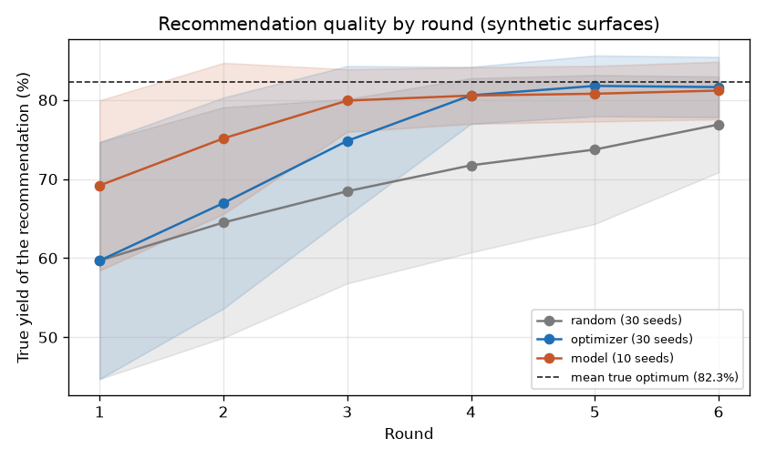

# Closed loop benchmark

Question: how many rounds does each strategy need to recommend a near optimal condition? The surfaces and the LC/MS readings are synthetic.

After each round, the recommendation is the tested condition with the highest measured mean. It is scored by its true yield on the noise free surface. Each seed is a different synthetic surface (surface seed = seed). Round 1 is the same Latin hypercube for every strategy on a seed. 8 conditions x 3 replicates per round, noise sd 2.5, injection failures on.

This run used the fast path: the plan's volumes stand in for the simulator's ledger, and compile and simulate are skipped. `labauto loop` runs the full path.

Command: `labauto benchmark --strategies random,optimizer,model --seeds 30 --model-seeds 10 --rounds 6 --run-dir runs/benchmark/live`

## Mean true yield of the recommendation (%)

| Strategy | Seeds | Round 1 | Round 2 | Round 3 | Round 4 | Round 5 | Round 6 |
|---|---|---|---|---|---|---|---|
| random | 30 | 59.7 | 64.5 | 68.5 | 71.7 | 73.7 | 76.9 |
| optimizer | 30 | 59.7 | 67.0 | 74.8 | 80.6 | 81.8 | 81.6 |
| model | 10 | 69.2 | 75.1 | 79.9 | 80.6 | 80.8 | 81.2 |

## Share of seeds within 3 points of the optimum

| Strategy | Seeds | Round 1 | Round 2 | Round 3 | Round 4 | Round 5 | Round 6 |
|---|---|---|---|---|---|---|---|
| random | 30 | 0.07 | 0.17 | 0.20 | 0.30 | 0.30 | 0.37 |
| optimizer | 30 | 0.07 | 0.27 | 0.47 | 0.73 | 1.00 | 1.00 |
| model | 10 | 0.20 | 0.60 | 0.80 | 0.90 | 0.90 | 0.90 |

Mean true optimum over the 30 surfaces: 82.3%.

The model ran on 10 seeds and the others on more, so the tables above do not compare them on the same seeds. See "On the model's seeds" below.

- model: 2 of 50 decided rounds fell back to the optimizer's picks.
- random: 1 s for 30 seeds.
- optimizer: 287 s for 30 seeds.
- model: 3998 s for 10 seeds.
- model: its calls are recorded in `runs/benchmark/live/model/`, one file per seed. Model calls: 126 made in this run, 0 replayed from an earlier run in that folder.

## On the model's seeds

These tables score every strategy on seeds 1 to 10, the only seeds the model ran on, so compare the model with the others here and not in the tables above.

### Mean true yield of the recommendation (%)

| Strategy | Seeds | Round 1 | Round 2 | Round 3 | Round 4 | Round 5 | Round 6 |
|---|---|---|---|---|---|---|---|
| random | 10 | 69.2 | 70.1 | 71.9 | 74.4 | 74.4 | 78.1 |
| optimizer | 10 | 69.2 | 73.9 | 78.3 | 80.2 | 81.5 | 81.0 |
| model | 10 | 69.2 | 75.1 | 79.9 | 80.6 | 80.8 | 81.2 |

### Share of seeds within 3 points of the optimum

| Strategy | Seeds | Round 1 | Round 2 | Round 3 | Round 4 | Round 5 | Round 6 |
|---|---|---|---|---|---|---|---|
| random | 10 | 0.20 | 0.30 | 0.30 | 0.40 | 0.40 | 0.60 |
| optimizer | 10 | 0.20 | 0.60 | 0.80 | 0.80 | 1.00 | 1.00 |
| model | 10 | 0.20 | 0.60 | 0.80 | 0.90 | 0.90 | 0.90 |

Mean true optimum over these 10 surfaces: 81.7%.

Model: qwen3.8:27b  
Date: 2026-11-12  
Git commit: v0.3-closed-loop-25-gacb91a5
