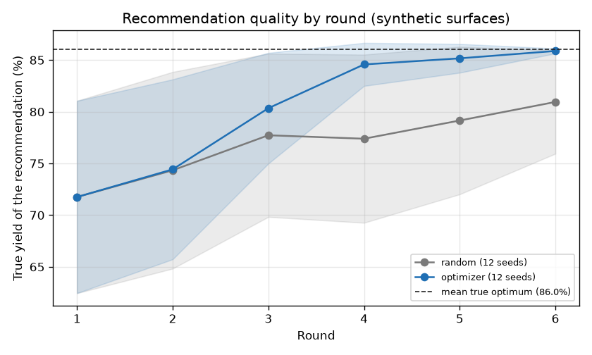

# Closed loop benchmark

Question: how many rounds does each strategy need to recommend a near optimal condition? The surfaces and the LC/MS readings are synthetic.

After each round, the recommendation is the tested condition with the highest measured mean. It is scored by its true yield on the noise free surface. Every seed uses the same surface (surface seed 0); only the campaign seed changes. Round 1 is the same Latin hypercube for every strategy on a seed. 8 conditions x 3 replicates per round, noise sd 2.5, injection failures on.

This run used the fast path: the plan's volumes stand in for the simulator's ledger, and compile and simulate are skipped. `labauto loop` runs the full path.

Command: `labauto benchmark --strategies random,optimizer --seeds 12 --model-seeds 3 --rounds 6 --surface-seed 0 --out docs/benchmark_check.md --png docs/img/benchmark_check.png`

## Mean true yield of the recommendation (%)

| Strategy | Seeds | Round 1 | Round 2 | Round 3 | Round 4 | Round 5 | Round 6 |
|---|---|---|---|---|---|---|---|
| random | 12 | 71.8 | 74.3 | 77.7 | 77.4 | 79.2 | 80.9 |
| optimizer | 12 | 71.8 | 74.4 | 80.3 | 84.6 | 85.2 | 85.9 |

## Share of seeds within 3 points of the optimum

| Strategy | Seeds | Round 1 | Round 2 | Round 3 | Round 4 | Round 5 | Round 6 |
|---|---|---|---|---|---|---|---|
| random | 12 | 0.08 | 0.17 | 0.25 | 0.25 | 0.33 | 0.42 |
| optimizer | 12 | 0.08 | 0.08 | 0.33 | 0.83 | 0.83 | 1.00 |

True optimum of surface seed 0: 86.0%.

- random: 0 s for 12 seeds.
- optimizer: 50 s for 12 seeds.

Model: none (no model strategy was run)  
Date: 2026-11-11  
Git commit: b306dfd
