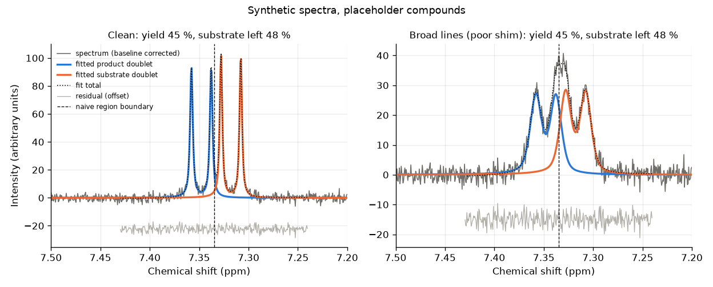

# NMR readout check

The spectra and the compounds in them are synthetic. The substrate, product and internal standard are placeholder species with made up signals. No real molecule and no real spectrometer is modeled. These numbers say how the evaluator behaves on this simulator, not how it would do on real samples.

Command: `labauto nmr-check --out docs/nmr.md --png docs/img/nmr_fit.png --seed 0`

## What was measured

Each case has 30 spectra: true yields of 5 to 95 % in steps of 10, 3 replicates each, seed 0. Conversion is the yield plus 2 to 8 points, so some substrate is always left except near 100 %. Each replicate uses the same random draws in every case, so the cases differ only by what the case changes. The error of a method is its yield minus the yield the spectrum was built with, in percentage points.

Each spectrum here is built at exactly the yield in the table. Plate spectra (as `labauto nmr` and the reviewer fault cases make them) are not: each well starts from its true yield plus an independent normal draw with sd 2 points, which stands for instrument and sample handling error. That draw comes from the NMR's own random stream, so it is independent of the LC/MS draw for the same well. nmr-check skips that draw, so the errors below are evaluator error only.

Simulated spectra: 16384 points from 0 to 10 ppm at 400 MHz. Lines 1.2 Hz wide at half height, 90% Lorentzian, Gaussian noise with sd 2, a slow polynomial baseline, random shift offsets and a random phase of about 1 degree. Internal standard singlet at 6.10 ppm (3H). Substrate: doublet 7.32 ppm (J 8 Hz, 2H) and singlet 3.80 ppm (3H). Product: doublet 7.35 ppm (J 8 Hz, 2H) and singlet 3.86 ppm (3H). The doublets sit side by side, with inner lines 4 Hz apart (7.33 and 7.34 ppm). The lines are resolved, but their tails cross any fixed boundary between them. Nuisance peaks: a solvent singlet at 2.50 ppm and broad water near 3.33 ppm.

Cases:

- clean: the defaults above.
- broad_lines: poor shim, lines 3.5 to 4.5 times wider and 60% Lorentzian.
- phase_error: a zero-order phase error of 15 degrees.
- low_signal: a dilute sample. Every sample signal is 10 times smaller; the noise is the same.
- impurity: an extra 3H singlet under the product singlet in every spectrum, 2 to 20 % of the standard's amount. It raises the singlet's yield by 2 to 20 points, so its size straddles the 5 point consistency flag.

Impurity sweep: 120 more spectra (12 per yield level, their own random draws), each with an impurity drawn the same way. Each is fitted twice: with the impurity, and with the impurity left out but every other draw and the noise the same. This measures how often the consistency flag catches an impurity of a given size, and how often it fires without one.

Methods:

- naive integration, unphased: subtract the same polynomial baseline the fitter uses, then sum fixed ppm regions (standard 6.04 to 6.16, product doublet 7.335 to 7.4, product singlet 3.83 to 3.92) after referencing the axis so the standard's tallest point is at 6.10 ppm. No fitting and no phase correction. Its yield is the mean of the doublet and singlet estimates. The evaluator reports this one as `naive_yield_pct`.
- naive integration with autophase: the same, after a zero-order phase correction taken from the internal standard alone (the imaginary part is rebuilt with a Hilbert transform, and the phase is the angle of the standard's complex integral). This is the fair comparison for phase errors.
- lineshape fit: `lineshape least squares (classical)` in `src/labauto/nmr_analysis.py`. Least squares of the known signal patterns with fitted phase, shifts, line widths and line shape. Each of the four sample signals has its own shift offset and width ratio, and the singlets have their own line shape share, so the doublet and singlet are independent estimates that share only the phase, the overall shift, and the standard's area and line width. Its yield (`yield_pct`) is the plain mean of the doublet and singlet estimates, flagged or not.

### Why the fitter's errors here are a lower bound

The fitter is scored on the simulator it was written next to. It knows almost everything the simulator does:

- the same pseudo-Voigt line function (a Lorentzian and Gaussian mix, with matching dispersion parts for phasing);
- the same centres, multiplicities and proton counts for every signal;
- J bounded to 7.5 to 8.5 Hz around the simulated 8 Hz;
- first-order doublets with equal line heights (no roofing), as simulated;
- a zero-order phase only, which is the only phase error the simulator makes;
- a baseline family that contains the simulator's: the simulator adds a Legendre polynomial of degree 3 over the whole axis, and the fitter subtracts a degree 4 Legendre fit over the same axis.

Not modelled by either: T1 weighting (signals that relax at different rates between scans), 13C satellites, second-order roofing of close doublets, first-order (frequency dependent) phase errors, and asymmetric line shapes from poor shims. Real spectra have all of these, so real errors would be larger.

## Yield error by case and method

All spectra, flagged or not. Points of yield.

| Case | Method | Mean abs error | Max abs error | Mean error (bias) |
|---|---|---|---|---|
| clean | naive integration, unphased | 1.69 | 4.57 | -0.25 |
| clean | naive integration with autophase | 1.37 | 3.73 | -0.12 |
| clean | lineshape fit (yield_pct) | 0.29 | 0.69 | -0.06 |
| broad_lines | naive integration, unphased | 4.03 | 9.42 | -0.18 |
| broad_lines | naive integration with autophase | 3.83 | 9.66 | -0.11 |
| broad_lines | lineshape fit (yield_pct) | 0.54 | 1.32 | +0.03 |
| phase_error | naive integration, unphased | 12.42 | 15.20 | -12.42 |
| phase_error | naive integration with autophase | 1.42 | 3.65 | -0.14 |
| phase_error | lineshape fit (yield_pct) | 0.27 | 0.66 | -0.05 |
| low_signal | naive integration, unphased | 4.44 | 14.01 | +0.09 |
| low_signal | naive integration with autophase | 6.13 | 23.75 | +0.10 |
| low_signal | lineshape fit (yield_pct) | 2.81 | 6.12 | -0.40 |
| impurity | naive integration, unphased | 5.44 | 10.34 | +5.42 |
| impurity | naive integration with autophase | 5.57 | 10.57 | +5.56 |
| impurity | lineshape fit (yield_pct) | 5.81 | 10.41 | +5.81 |

## What the numbers show

- clean: the fit's mean abs error is 0.29 points, smaller than naive integration with autophase (1.37). Naive integration of the singlet region alone gives 0.71; its doublet region gives 2.37, because the line tails of the two doublets cross the fixed boundary between them at 7.335 ppm.
- broad_lines: naive integration with autophase grows to 3.83 (doublet region 6.63); the fit's error is 0.54. NMR_BROAD_LINES is raised on 100% of these spectra.
- phase_error: unphased naive integration is off by -12.42 points on average. With autophase it is off by -0.14 (mean abs error 1.42), which is the fair comparison. The fit's mean abs error is 0.27, and NMR_PHASE_CORRECTED is raised on 100%. The phase each finds is off by 0.4 degrees (autophase) and 0.1 degrees (fit) on average.
- low_signal: the fit's errors reach 6.12 points. NMR_LOW_SNR is raised on 100% of these spectra and 100% are excluded. Naive integration with autophase is larger than unphased here (6.13 against 4.44): a phase taken from a weak standard is off by 3.0 degrees on average (against 0.4 in the clean case), and a small phase error lets the dispersion tail of the large water peak change the area in the singlet region.
- impurity: the fitted doublet's mean abs error is 0.48, against 0.49 on the same spectra without the impurity (mean change 0.02, largest 0.21). The impurity goes into the singlet (bias +11.68), and so half of it into yield_pct (bias +5.81). The fit does not remove an impurity; it keeps the doublet clean of it and flags the gap when it is over 5 points.
- impurity sweep: NMR_SIGNAL_INCONSISTENT catches 2/23 (9%) impurities under 5 points, 28/30 (93%) from 5 to 10 points, and 67/67 (100%) of 10 points and over. On the same spectra without the impurity it is raised on 0/120 (0%). The flag keeps the well, so a person or the reviewer decides what to do with it. 21 of the 23 impurities under 5 points pass every fixed rule unflagged.

## Error by signal

Mean abs error / max abs error, points of yield, all spectra.

| Case | naive unphased, doublet region | naive unphased, singlet region | naive autophase, doublet region | naive autophase, singlet region | fit, doublet | fit, singlet |
|---|---|---|---|---|---|---|
| clean | 2.74 / 6.39 | 0.90 / 2.75 | 2.37 / 6.32 | 0.71 / 1.79 | 0.49 / 1.23 | 0.23 / 0.67 |
| broad_lines | 6.85 / 14.97 | 1.63 / 4.04 | 6.63 / 16.71 | 1.76 / 4.69 | 0.86 / 2.37 | 0.52 / 1.38 |
| phase_error | 14.50 / 18.81 | 10.34 / 12.80 | 2.39 / 6.14 | 0.71 / 2.20 | 0.46 / 1.22 | 0.23 / 0.74 |
| low_signal | 7.03 / 20.79 | 5.17 / 13.76 | 7.53 / 17.68 | 7.34 / 34.22 | 4.67 / 9.92 | 2.18 / 5.86 |
| impurity | 2.74 / 6.39 | 11.58 / 20.45 | 2.37 / 6.32 | 11.71 / 20.51 | 0.48 / 1.23 | 11.68 / 20.63 |

## Clean and impurity side by side

The clean and impurity cases are the same 30 spectra except for the impurity. Mean abs error / max abs error in points, and how far each estimate moved when the impurity was added (mean / largest).

| Estimate | Clean | With impurity | Change, same spectrum |
|---|---|---|---|
| fit, doublet | 0.49 / 1.23 | 0.48 / 1.23 | 0.02 / 0.21 |
| fit, singlet | 0.23 / 0.67 | 11.68 / 20.63 | 11.75 / 19.96 |
| fit, yield_pct | 0.29 / 0.69 | 5.81 / 10.41 | 5.87 / 9.99 |
| naive autophase, doublet region | 2.37 / 6.32 | 2.37 / 6.32 | 0.00 / 0.00 |

## Impurity detection by size

Impurity sweep, 120 spectra. Size is how many points the impurity adds to the singlet's yield (100 times its amount relative to the standard). The flag is NMR_SIGNAL_INCONSISTENT (doublet and singlet more than 5 points apart). Any flag counts every per spectrum code the fitter raised. The first row is the same spectra with the impurity left out, so its rates are false alarms. Doublet change is how far the fitted doublet moved when the impurity was added.

| Impurity size, points | Spectra | Sizes drawn | NMR_SIGNAL_INCONSISTENT | Any flag | Fitted singlet minus doublet, mean | Doublet change, mean / largest |
|---|---|---|---|---|---|---|
| none (same spectra, no impurity) | 120 | n/a | 0/120 (0%) | 0/120 (0%) | n/a | n/a |
| under 5 | 23 | 2.3 to 5.0 | 2/23 (9%) | 2/23 (9%) | +3.65 | 0.01 / 0.07 |
| 5 to 10 | 30 | 5.0 to 9.9 | 28/30 (93%) | 28/30 (93%) | +8.08 | 0.03 / 0.19 |
| 10 and over | 67 | 10.1 to 20.0 | 67/67 (100%) | 67/67 (100%) | +16.12 | 0.05 / 0.64 |
| all sizes | 120 | 2.3 to 20.0 | 97/120 (81%) | 97/120 (81%) | +11.72 | 0.04 / 0.64 |

## Quality flags raised by the fitter

Share of spectra with each flag. Thresholds: fit residual over 1.5 times the noise (NMR_FIT_POOR), standard peak under 50 noise sd (NMR_LOW_SNR), doublet and singlet yields more than 5 points apart (NMR_SIGNAL_INCONSISTENT), fitted phase over 5 degrees (NMR_PHASE_CORRECTED), standard line wider than 2.5 Hz (NMR_BROAD_LINES). Fit poor and low SNR exclude the well; the others keep it.

| Case | Spectra | Median standard SNR | NMR_FIT_POOR | NMR_LOW_SNR | NMR_SIGNAL_INCONSISTENT | NMR_PHASE_CORRECTED | NMR_BROAD_LINES | Excluded | Fit max abs error, kept spectra |
|---|---|---|---|---|---|---|---|---|---|
| clean | 30 | 337 | 0% | 0% | 0% | 0% | 0% | 0% | 0.69 |
| broad_lines | 30 | 95 | 0% | 0% | 0% | 0% | 100% | 0% | 1.32 |
| phase_error | 30 | 334 | 0% | 0% | 0% | 100% | 0% | 0% | 0.66 |
| low_signal | 30 | 34 | 0% | 100% | 43% | 0% | 0% | 100% | none kept |
| impurity | 30 | 337 | 0% | 0% | 80% | 0% | 0% | 0% | 10.41 |

## Speed

Approximate. Mean wall time per spectrum over the 150 case spectra, from one run on the machine that ran the command, with linear algebra on one thread. These times depend on the machine and on what else it was doing; read them as an order of magnitude.

| Method | Milliseconds per spectrum, about |
|---|---|
| naive integration, unphased | 2.7 |
| naive integration with autophase | 5.8 |
| lineshape fit | 31 |

## Figure

The 7.2 to 7.5 ppm region of one spectrum at 45 % yield, clean and with broad lines, with the fitted product and substrate doublets drawn on top. The dashed line is the fixed boundary naive integration uses between the two doublets.

Date: 2026-11-11  
Git commit: 0d9cc9c
